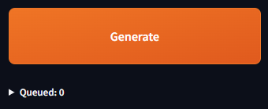
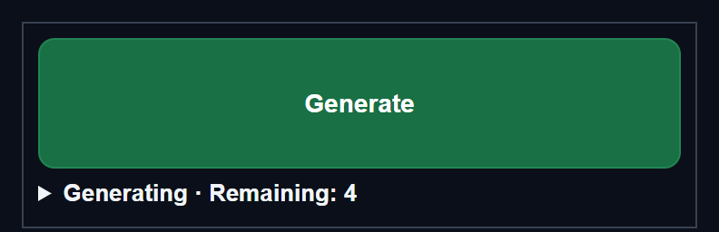
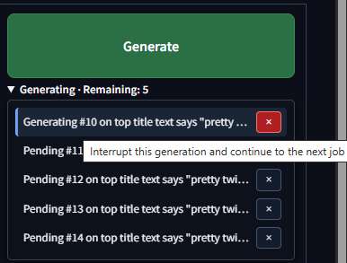
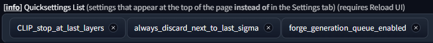

# Forge Neo Generation Queue / 生成キュー

[English README](README.md)

v0.1.0。Forge Neoの **txt2img** で、既存のGenerateを押すたびに生成を予約する拡張です。初期設定はOFFです。

## インストール

次のどちらかで導入できます。**Install from URLは、Available一覧への登録がなくても使えます。** 二重に導入しないでください。

### Install from URL

1. Forge Neoの **Extensions → Install from URL** を開きます。
2. `https://github.com/ukr8b3g-cmyk/Forge-Neo-Generation-Queue.git` を入力して **Install** を押します。
3. 通常のランチャーでForge Neoを再起動し、ブラウザーを再読み込みします。

### Git clone

Gitが必要です。**Forge Neoのインストールフォルダー**でターミナルを開き、実行します。

```sh
git clone https://github.com/ukr8b3g-cmyk/Forge-Neo-Generation-Queue.git extensions/Forge-Neo-Generation-Queue
```

通常のランチャーでForge Neoを再起動し、ブラウザーを再読み込みします。追加Pythonパッケージは不要です。導入済みの場合は二重にcloneしないでください。

## 更新

キューの完了を待ってForge Neoを終了し、**Forge Neoのインストールフォルダー**で実行します。

```sh
git -C extensions/Forge-Neo-Generation-Queue pull --ff-only
```

更新後、Forge Neoを起動してブラウザーを再読み込みします。ローカル変更や履歴の分岐でGitが停止した場合は、その変更を保護してから解決してください。強制リセットは不要です。

この更新方法はGitでcloneした配置が対象です。ZIPや手動コピーで`.git`がない場合、`git pull`は使えません。既存の拡張フォルダーを`extensions`の外へバックアップしてから、上記のインストールコマンドでcloneしてください。有効な配置は1つにします。

表示言語はWebUIの`localization`設定に従います。日本語（`ja`／`ja_JP`等）なら日本語、英語・未設定・`None`・その他のロケールなら英語です。OSやブラウザーの言語は参照しません。英語UIの設定場所は **Settings → Generation Queue → Enable generation queue (txt2img)** です。言語変更後の設定見出し・チェックボックスはWebUIの再読み込みで更新します。

## 使い方

| 待機時 | 生成中 |
| --- | --- |
|  |  |

オレンジ色は待機時、緑色は生成中です。提供画像の **Queued** は待機分だけを数える旧表示です。現在は生成中を含む **残り N件 / Remaining: N** に統一しています。3回登録して、まだ完了・取消がなければ3件です。最新版ではGenerate直下の間隔もさらに詰めています。



現在の詳細表示例です。**Generating · Remaining: 4** は、**生成中1件＋待機3件＝残り4件**を表します。一覧も4行で、完了・取消済みの履歴は表示しません。最新版では生成中の行も緑背景・白文字になります（画像は行の色変更前）。各行の **×** で、生成中のジョブを中断、または待機中のジョブを取り消せます。

詳細ポップアップの背景は暗い色で **不透明度80％（透明度20％）**。下の操作画面が薄く見える程度にしています。

1. 拡張配置後、通常のランチャーからForge Neoを再起動し、ブラウザーを再読み込みします。
2. **Settings → 生成キュー → 生成キューを有効にする（txt2img）** をONにしてApply settings。
3. 上部に置く場合は **Settings → User interface → Quicksettings List** へ `forge_generation_queue_enabled` を手動で追加し、Apply settings → Reload UI。
4. Generateを押すと1ジョブを予約します。生成中も追加できます。Batch Count／Batch Sizeは1ジョブの中に含まれます。
5. Generate直下は「生成中 · 残り N件」の1行表示です。件数は生成中と待機中の合計です。生成中のGenerateは濃い緑になり、完了すると元の色へ戻ります。
6. 件数をクリックすると、生成中・待機中だけの詳細がポップアップします。完了・取消済みの履歴は表示しません。待機行の **×** はその予約を取り消し、生成中の **×** は中断を要求します。中断終了後、次の予約へ進みます。詳細を開いても画面下の配置は動きません。

### Settingsの場所


画像のように、ほかの拡張と同じ一覧の **Generation Queue** を開きます。日本語UIでは **生成キュー** です。Quicksettingsに登録せず、この設定ページだけでもON/OFFできます。

### Quicksettingsへの登録



**Settings → User interface → Quicksettings List** に **`forge_generation_queue_enabled`** を追加します。Settingsで `Quicksettings` を検索しても見つかります。画像のように既存の項目を残して追加し、**Apply settings → Reload UI** の順に押してください。Reload UIの前にキューを空にします。

再読み込み後はWebUI上部に **Enable generation queue (txt2img)** のチェックボックスが表示されます。日本語UIでは **生成キューを有効にする（txt2img）** です。

Quicksettings Listへの自動追加・既存設定の書き換えは行いません。追加後のチェックボックスのON/OFFに本体再起動は不要です。

## 動作と範囲

- 受付時のGradio生成入力をコピーします。プロンプト・Seed・解像度・Steps・CFG・Hires設定・生成欄の拡張入力は既存の入力列をそのまま使用します。変更した入力がUIに反映され、残り件数が増えたことを確認してください。
- Seed `-1`、Dynamic Prompts等の展開は既存の生成処理に任せます。乱数展開済みの文章や外部ワイルドカードファイルを予約時に固定する機能ではありません。
- 生成エンジン、モデル読込、画像保存、GPU排他ロックはForgeのものを使用します。GPU生成は1件ずつです。
- 待機＋実行中は本体全体で最大32件。表示・取消・再開は操作元ごとに区別します。
- **同一のモデル・共通設定での利用が対象**です。保存されたSettingsやスタイル定義が予約時から変わると、次の予約を保持して停止します。元に戻して「再開」、または×で取り消してください。設定全体の自動復元はしません。
- 停止した操作元に未完了ジョブがなくなれば、停止状態を解除します。他の操作元のジョブも開始前に設定を確認します。再開対象が残らないエラーも、詳細を確認できる表示を維持します。
- OFFにしても登録済みのジョブは継続します。完了までは件数表示と詳細内の×を残し、新規予約は受け付けません。空になると従来のGenerateへ戻ります。
- 生成エラーでは後続を保持して停止します。原因を確認して「再開」してください。失敗したジョブ自体は自動再試行しません。
- Generate foreverは併用しません。キューモードではtxt2imgの自動繰り返しを解除します。
- 同じブラウザータブの通常再読み込みには再接続します。ページを閉じても登録済み分は本体で実行されます。別タブ・別ブラウザーへの所有権引継ぎはありません。
- **Forgeの再起動・Reload UI・Reload script bodiesでのキュー永続化はありません。** キューを空にしてから行ってください。
- 元のギャラリーへ最新の完了結果を表示します。過去の全ジョブの画像一覧は作らず、画像の保存先は既存設定に従います。
- 最新結果は操作元のタブが受信確認するまで保持します。未完了ジョブがない操作元の結果は完了後**30分**で期限切れになります。実行・待機中または未受信結果を持つ操作元は合計**32件**までで、枠が満杯なら新しい操作元の受付を警告付きで止めます。元のタブを再接続するか期限切れを待ってください。受付済みジョブには結果通知用の枠を確保し、他の操作元の完了で未受信結果を消しません。同じ操作元では、従来どおり新しい結果が古い結果を置き換えます。
- img2img、独立したHiresボタン、API生成、他の拡張ボタンはキュー受付へ変更しません。これらを並行操作するとForgeの共通GPUロックで待機します。

## 実装・互換性

Forge Neo本体のファイルは編集しません。標準コールバックで設定とUIを作り、UI完成後に既存のtxt2img Generate／プロンプト送信イベントだけを接続します。Gradioアプリ自体の作り直しや認証経路の追加はありません。

対象として確認したローカル本体：`2900d5948a17ec993075fb810a695ce4f674bd0c`、Gradio `4.40.0`。txt2imgの呼出先・JS・出力数が想定と異なる場合は、起動ログへ警告し、元のGenerateを保持します。他の本体バージョンの互換性は未確認です。

新規ライブラリーのインストールは不要です。拡張を無効化して本体を再起動すれば、元の生成処理になります。Quicksettingsに登録した項目は、無効化前に手動で一覧から外してください。

## 検証

`tests/test_queue.py`：順序・入力コピー・重複防止・個別取消・開始との競合・失敗停止・所有者・件数上限。

開発時には、導入済みGradioを用いたイベント接続・入力処理・ユーザー識別・共通設定ガードと、隔離Chrome＋CPU模擬生成によるUI統合検証も行いました。環境依存の検証スクリプトは公開リポジトリには含まれません。実Forge／GPU生成の検証とは区別します。

自動検証と実GPU確認の違いは [TESTING.md](TESTING.md) を参照してください。掲載画像はユーザーのWebUIから提供された画像を切り抜いたものです。

## プロジェクト情報

- [変更履歴](CHANGELOG.md)
- [不具合報告・開発への参加](CONTRIBUTING.md)：英語・日本語に対応
- [テストと検証範囲](TESTING.md)

## ライセンス

[MITライセンス](LICENSE)。Copyright (c) 2026 ukr8b3g-cmyk。
Forge Neo本体や他の第三者プロジェクトには、それぞれのライセンスが適用されます。
